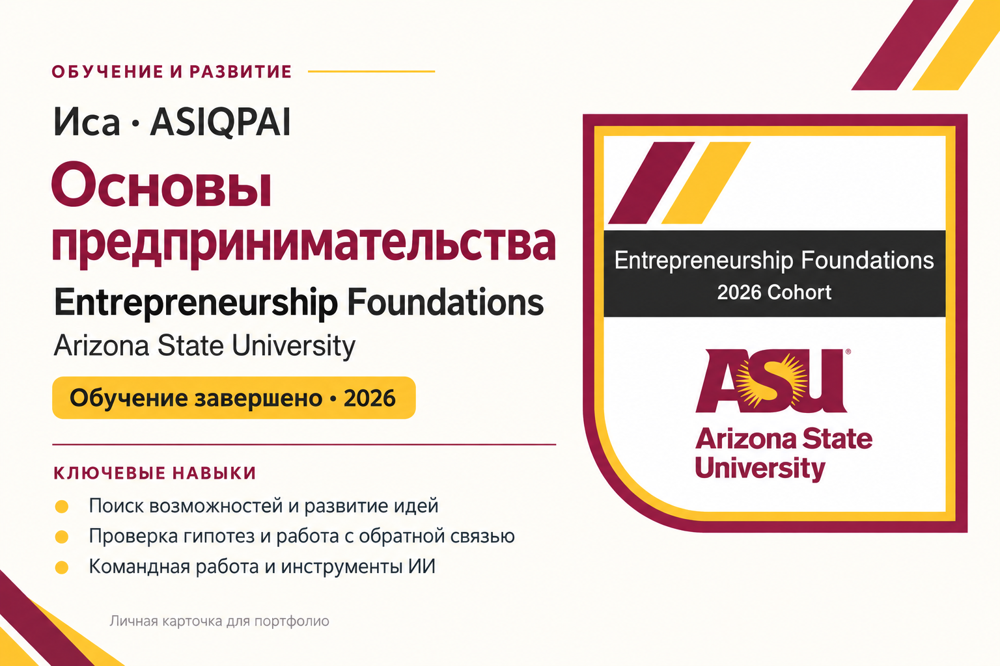

# QazTrap — Portfolio

I build practical AI, fintech, and Telegram products — from idea to working prototype.

This portfolio highlights three projects I am actively developing: **QazLedger AI**, **QazLedger MoneyGraph**, and the **Asiqpai Telegram Mini App**.

---

## QazLedger AI

**AI-assisted accounting workflow for Kazakhstan businesses**

QazLedger AI is designed to reduce repetitive accounting work around bank statements and 1C.

### What it does

- analyzes structured banking transactions;
- suggests an accounting classification;
- explains the proposed decision;
- supports human review before document creation;
- prepares **unposted** draft documents in 1C;
- helps prevent duplicate document creation;
- supports internal transfers between company bank accounts.

### Approach

```text
Bank Statement
→ Analysis
→ Suggested Classification
→ Human Review
→ Selected Transactions
→ Unposted 1C Draft
```

The accountant remains responsible for the final verification and posting.

### Technologies

- 1C: Accounting for Kazakhstan
- Node.js / Express
- JavaScript
- OpenAI API
- structured banking data

---

## QazLedger MoneyGraph

**Explainable AML transaction-network analysis**

MoneyGraph is an AML-oriented module developed around the HackAlem AI transaction-network challenge.

It turns transaction data into an explainable graph that helps an analyst understand how funds move through a network and which nodes may deserve earlier review.

### What it does

- builds a directed transaction graph;
- analyzes incoming and outgoing flows;
- calculates PageRank and betweenness centrality;
- assigns one of six functional node roles;
- calculates `role_score` and `priority_score`;
- performs Louvain community detection;
- generates explainable evidence for each node;
- creates ranked Top-20 results;
- provides an interactive GID Viewer.

### Functional roles

- `consolidator`
- `distributor`
- `transit`
- `terminal`
- `coordinator`
- `peripheral`

### Verified local run

```text
Nodes: 2,248
Edges: 3,119
Clusters: 91
Top ranked nodes: 20
Pipeline runtime: ~4 seconds
```

### Workflow

```text
Parquet Data
→ Directed Graph
→ Graph Metrics
→ Roles + Clusters
→ Priority Score
→ CSV Outputs
→ Interactive GID Viewer
→ AML Analyst Review
```

The system is designed to support analyst review — not to declare a person or account guilty of wrongdoing.

### Repository

https://github.com/QazTrap/qazledger-ai-moneygraph

---

## Asiqpai Telegram Mini App

**A consumer-facing product built inside Telegram**

The Asiqpai Mini App is a separate product project focused on building an interactive user experience directly inside Telegram.

### Product direction

- Telegram-native interface;
- music and creator-oriented experience;
- interactive mechanics;
- digital purchases using Telegram platform tools;
- community features;
- product experimentation inside a real user-facing environment.

### Why it matters in this portfolio

QazLedger demonstrates work on **financial workflows and AI analysis**.

MoneyGraph demonstrates **graph analytics, explainability, and AML-oriented tooling**.

Asiqpai demonstrates **consumer product design and Telegram Mini App development**.

Together they show experience across backend logic, data analysis, interfaces, integrations, and rapid prototyping.

### Links

Website: https://asiqpai.site/

Telegram: https://t.me/asiqpai_bot

---

## How I Work

My current approach is simple:

```text
Understand the problem
→ Build a small working version
→ Test it
→ Find what is missing
→ Improve it
→ Repeat
```

I use AI as a development and analysis tool, while keeping human review and real-user feedback central to important decisions.

---

## Current Focus

I am currently interested in:

- applied AI;
- fintech;
- accounting automation;
- AML and transaction-network analysis;
- Telegram Mini Apps;
- rapid prototyping;
- human-in-the-loop AI systems.

---

## Projects

| Project | Area | Status |
|---|---|---|
| QazLedger AI | AI + Accounting + 1C | Working prototype |
| QazLedger MoneyGraph | AML + Graph Analytics | Working prototype |
| Asiqpai Mini App | Telegram Product | Active project |

---

## Learning & Achievements

### Entrepreneurship Foundations — Arizona State University

**Completed · 2026 cohort**

Completed the Entrepreneurship Foundations learning experience and received a course completion badge from Arizona State University.

Skills developed:

- recognizing opportunities and connecting innovation to meaningful goals;
- critical thinking, creativity, adaptability, collaboration, and initiative;
- defining problems, testing assumptions, gathering feedback, and refining ideas;
- working with teams, ecosystem resources, and AI tools to move ideas forward.



*Personal portfolio card based on the course completion badge.*


### HackAlem AI — Certificate of Participation

**Participant · October 2026**

Participated in HackAlem AI, an agentic AI hackathon focused on practical AI development and problem-solving.

The event certificate references the Guinness World Records title *Most Participants in an Agentic AI Hackathon*. This is a **certificate of participation**, not a winning award or an individual Guinness World Records title.

[View HackAlem AI Certificate (PDF)](HackAlem-AI-Certificate.pdf)

**Skills and experience:** applied AI, rapid prototyping, problem-solving, and collaborative technical work.

---

## Contact

GitHub: https://github.com/QazTrap

Telegram: https://t.me/asiqpai
